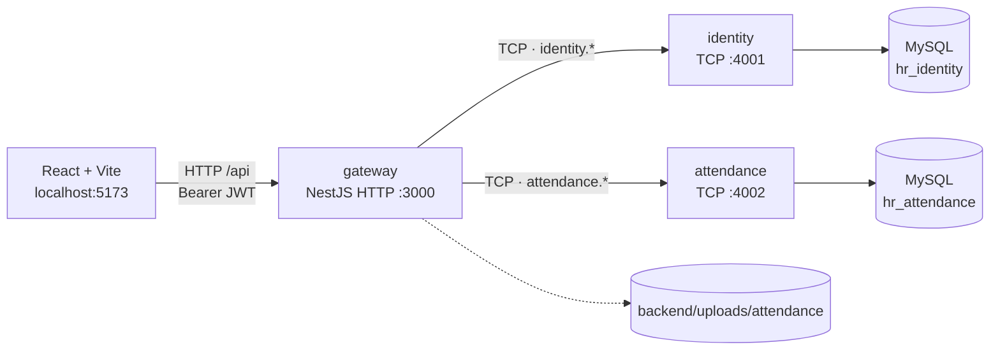
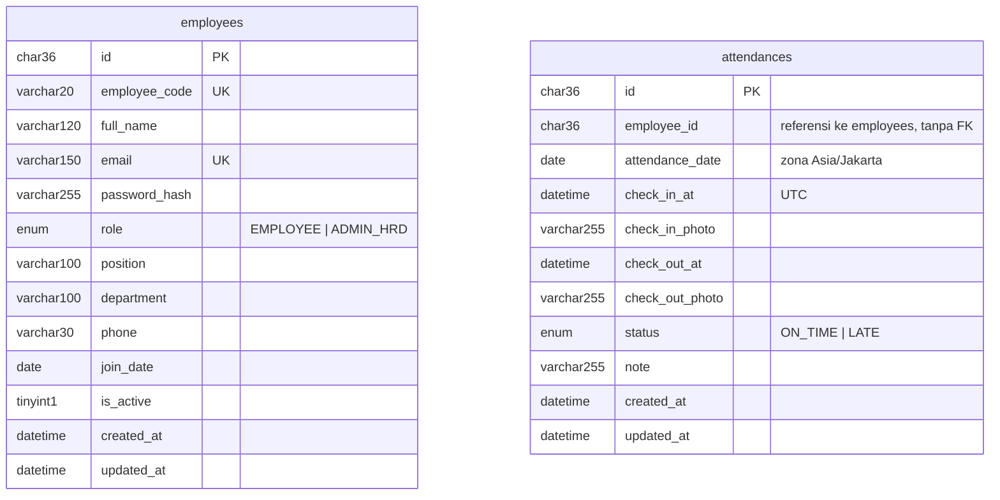

# DexaHR — Absensi WFH & Monitoring Karyawan

Satu aplikasi web dengan dua peran:

- **EMPLOYEE** — login, absen masuk/pulang dengan foto bukti, lihat riwayat sendiri.
- **ADMIN_HRD** — kelola data master karyawan (tambah/ubah/nonaktifkan) dan pantau seluruh absensi (read-only).

Stack: React + Vite (frontend), NestJS monorepo — gateway HTTP + microservice `identity` & `attendance` (TCP), MySQL 8.

## Arsitektur



- Frontend hanya bicara dengan gateway; service TCP tidak diekspos ke luar.
- Satu instance MySQL, dua database terpisah, tanpa foreign key lintas database.

## Database



## Prasyarat

- Node.js 20.19+
- Docker Desktop (MySQL)
- npm

## Menjalankan dari nol

```bash
# 1. Dependensi
npm install
npm --prefix backend install
npm --prefix frontend install

# 2. MySQL
npm run db:up         # docker compose up -d

# 3. Environment
cp .env.example .env  # sesuaikan DB_PASSWORD dan JWT_SECRET bila perlu

# 4. Skema + data contoh
npm run migrate       # buat database + tabel
npm run seed          # akun + absensi contoh

# 5. Jalankan semua proses
npm run dev           # gateway, identity, attendance, frontend
```

Setelah `npm run dev`:

| Proses           | Alamat                           |
| ---------------- | -------------------------------- |
| Frontend         | http://localhost:5173            |
| Gateway API      | http://localhost:3000/api        |
| Health check     | http://localhost:3000/api/health |
| identity (TCP)   | 127.0.0.1:4001                   |
| attendance (TCP) | 127.0.0.1:4002                   |

MySQL disimpan di volume Docker `dashboard-karyawan_mysql_data`. `MYSQL_ROOT_PASSWORD` hanya dipakai saat volume masih kosong; untuk mengganti `DB_PASSWORD` pada volume yang sudah ada, jalankan `npm run db:reset` (hapus volume lalu buat ulang).

## Akun seed (hanya untuk lokal)

| Role      | Email               | Password       |
| --------- | ------------------- | -------------- |
| ADMIN_HRD | `admin@example.com` | `Admin123!`    |
| EMPLOYEE  | `budi@example.com`  | `Employee123!` |
| EMPLOYEE  | `sari@example.com`  | `Employee123!` |

## Endpoint

Prefix `/api`. Semua endpoint kecuali login butuh header `Authorization: Bearer <token>`.

### Auth

| Method | Path          | Role   | Keterangan                                                         |
| ------ | ------------- | ------ | ------------------------------------------------------------------ |
| POST   | `/auth/login` | publik | `{ email, password }` → `{ accessToken, user }` (rate limit 5/menit/IP) |
| GET    | `/auth/me`    | semua  | Profil dari token                                                  |

### Karyawan

| Method | Path                   | Role      | Keterangan                                     |
| ------ | ---------------------- | --------- | ---------------------------------------------- |
| GET    | `/employees`           | ADMIN_HRD | List + pagination, `search`, filter `isActive` |
| GET    | `/employees/next-code` | ADMIN_HRD | Pratinjau kode karyawan berikutnya             |
| GET    | `/employees/:id`       | ADMIN_HRD | Detail                                         |
| POST   | `/employees`           | ADMIN_HRD | Tambah karyawan (admin mengisi password awal)  |
| PATCH  | `/employees/:id`       | ADMIN_HRD | Ubah data; password opsional                   |
| DELETE | `/employees/:id`       | ADMIN_HRD | Nonaktifkan (soft delete)                      |

### Absensi

| Method | Path                                  | Role                   | Keterangan                                          |
| ------ | ------------------------------------- | ---------------------- | --------------------------------------------------- |
| GET    | `/attendances/today`                  | EMPLOYEE               | Status absen hari ini milik sendiri                 |
| POST   | `/attendances/check-in`               | EMPLOYEE               | `multipart/form-data`: `photo` wajib, `note` opsional |
| POST   | `/attendances/check-out`              | EMPLOYEE               | Sama seperti check-in, setelah `WORK_END_TIME`      |
| GET    | `/attendances/me`                     | EMPLOYEE               | Riwayat sendiri; filter `dateFrom`/`dateTo`         |
| GET    | `/attendances`                        | ADMIN_HRD              | Semua absensi + nama karyawan; filter tanggal/karyawan/status |
| GET    | `/attendances/summary`                | ADMIN_HRD              | Ringkasan hari ini                                  |
| GET    | `/attendances/:id/photo?type=in\|out` | pemilik atau ADMIN_HRD | Streaming foto, tidak publik                        |

Pagination: `page` (mulai 1), `limit` (default 10, maksimal 100).

## Catatan / Batasan

- Komunikasi antar-service memakai TCP tanpa message broker (cukup untuk tes; produksi sebaiknya Redis/NATS/RabbitMQ).
- Token JWT disimpan di `localStorage`, tanpa refresh token.
- Hapus karyawan = soft delete (`is_active = 0`); riwayat absensi tetap tersimpan.
- Foto absensi disimpan di filesystem `backend/uploads/attendance/YYYY/MM/` (git-ignored); database hanya menyimpan nama file. Backup harus mencakup dump database **dan** folder `uploads/`.

## Menjalankan test

```bash
npm test          # unit test + e2e login (Jest, backend)
npm run lint      # oxlint (backend) + ESLint (frontend)
npm run build     # build backend + frontend
```
