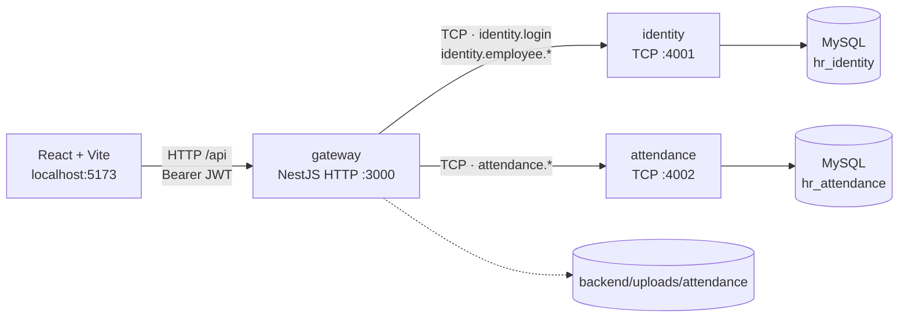
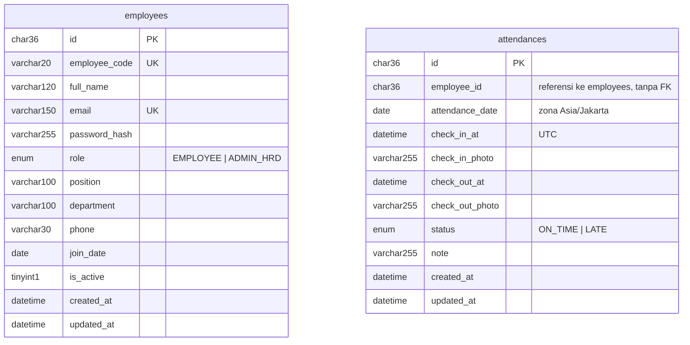

# Hadirku — Absensi WFH & Monitoring Karyawan

Satu aplikasi web dengan dua peran:

- **EMPLOYEE** — login, absen masuk/pulang dengan foto bukti, melihat riwayat absensinya sendiri.
- **ADMIN_HRD** — mengelola data master karyawan (tambah, ubah, nonaktifkan) dan memantau seluruh absensi secara *read only*.

Frontend React + Vite, backend NestJS dengan tiga proses terpisah (gateway HTTP + dua microservice TCP), dua database MySQL.

---

## Status pengerjaan

| Tahap | Isi | Status |
|---|---|---|
| 1 | Fondasi: repo, docker, monorepo NestJS, migration + seed, TCP ping, filter/pipe/helmet/CORS, frontend + token desain + routing dasar | **selesai** |
| 2 | Auth (login, JWT, guard role), CRUD karyawan di identity + endpoint gateway, halaman login, AppLayout, route guard, halaman `/admin/karyawan` | **selesai** |
| 3 | Absensi: check-in/out, upload foto, halaman `/absen` dan `/riwayat` | belum |
| 4 | Monitoring admin, modal foto, state lengkap, e2e, README final | belum |

Halaman `/absen`, `/riwayat`, `/admin/absensi`, dan `/admin/dashboard` sudah ada di dalam layout (navigasi, guard, dan styling aktif) tetapi isinya masih penanda "tahap berikutnya".

---

## Arsitektur



- Frontend hanya bicara dengan **gateway**. Service TCP tidak diekspos ke luar.
- Satu instance MySQL, dua database terpisah, **tanpa foreign key lintas database**. Attendance menyimpan `employee_id` sebagai referensi biasa.
- Gateway yang menerbitkan JWT; identity hanya memvalidasi kredensial dan menyimpan data karyawan.
- Error dari service dikirim sebagai `RpcException` dengan payload `{ statusCode, error, message }`, lalu dipetakan gateway menjadi respons HTTP dengan bentuk yang sama.
- Kalau gateway butuh nama karyawan (tahap 4), ia mengambil absensi dari attendance lalu memanggil `identity.employee.getMany` dengan daftar `employee_id` — data karyawan tidak diduplikasi.

### ER



- `hr_identity.employees` — unique `employee_code`, unique `email`.
- `hr_attendance.attendances` — unique `(employee_id, attendance_date)`, index `attendance_date`, index `status`.

---

## Stack

- **Backend**: NestJS 12 (mode monorepo), TypeORM (migration, `synchronize: false`), `class-validator` + `class-transformer`, `@nestjs/jwt` + `passport-jwt` + `bcrypt`, `helmet`, `@nestjs/throttler`, multer (tahap 3).
- **Database**: MySQL 8 via Docker.
- **Frontend**: React 19, Vite 8, React Router 7, TanStack Query 5, Axios, React Hook Form + Zod, Tailwind CSS 4.
- **Komponen UI**: dibuat sendiri di `frontend/src/components/ui/` (tanpa MUI/Ant/shadcn).

---

## Prasyarat

- Node.js 20 atau lebih baru
- Docker Desktop (untuk MySQL)
- npm

---

## Menjalankan dari nol

```bash
# 1. Dependensi
npm install
npm --prefix backend install
npm --prefix frontend install   # repo ini memakai yarn.lock; `yarn install` juga boleh

# 2. MySQL
npm run db:up                   # docker compose up -d (MySQL 8 di :3306)

# 3. Environment — satu file .env di root, dipakai compose + backend + script
cp .env.example .env
#    Nilai default sudah jalan untuk lokal (DB_PASSWORD=rootpassword, sama dengan
#    default docker-compose). Untuk apa pun selain lokal, ganti DB_PASSWORD dan
#    JWT_SECRET. Kalau ganti DB_PASSWORD untuk volume yang sudah ada,
#    jalankan `npm run db:reset`.

# 4. Skema + data contoh
npm run migrate                 # membuat database bila belum ada, lalu menjalankan migration
npm run seed                    # 3 akun + absensi contoh 7 hari terakhir

# 5. Jalankan semua proses
npm run dev                     # gateway, identity, attendance, frontend
```

Setelah `npm run dev`:

| Proses | Alamat |
|---|---|
| Frontend | http://localhost:5173 |
| Gateway API | http://localhost:3000/api |
| Health check (ping TCP ke kedua service) | http://localhost:3000/api/health |
| identity (TCP) | 127.0.0.1:4001 |
| attendance (TCP) | 127.0.0.1:4002 |

Script root lain: `npm run lint`, `npm run test`, `npm run build`, `npm run format`, `npm run db:down`, `npm run db:reset`.

---

## Akun seed (hanya lokal)

| Role | Email | Password |
|---|---|---|
| ADMIN_HRD | `admin@example.com` | `Admin123!` |
| EMPLOYEE | `budi@example.com` | `Employee123!` |
| EMPLOYEE | `sari@example.com` | `Employee123!` |

Seed juga mengisi absensi contoh untuk 5 hari kerja terakhir beserta file foto pratinjau (PNG yang dibuat oleh script seed). Semua akun ini **hanya untuk demo lokal** dan harus dihapus sebelum dipakai sungguhan.

---

## Endpoint

Prefix `/api`. Selain login, semua endpoint butuh header `Authorization: Bearer <token>`.

### Auth
| Method | Path | Role | Keterangan |
|---|---|---|---|
| POST | `/auth/login` | publik | `{ email, password }` → `{ accessToken, user }`. Rate limit 5/menit per IP |
| GET | `/auth/me` | semua | Profil dari token |

### Karyawan
| Method | Path | Role | Keterangan |
|---|---|---|---|
| GET | `/employees` | ADMIN_HRD | Pagination, `search` (nama/kode/email), filter `isActive`, `role` |
| GET | `/employees/:id` | ADMIN_HRD | Detail |
| POST | `/employees` | ADMIN_HRD | Tambah karyawan, admin mengisi password awal |
| PATCH | `/employees/:id` | ADMIN_HRD | Ubah data, password opsional, `isActive` untuk mengaktifkan kembali |
| DELETE | `/employees/:id` | ADMIN_HRD | Nonaktifkan (soft delete). Admin tidak bisa menonaktifkan akunnya sendiri |

Pagination: `page` (mulai 1), `limit` (default 10, maksimal 100). Bentuk respons list: `{ data, meta: { page, limit, total, totalPages } }`.

Format error seragam:

```json
{ "statusCode": 409, "error": "Conflict", "message": "Email sudah dipakai karyawan lain." }
```

### Health
| Method | Path | Keterangan |
|---|---|---|
| GET | `/health` | Ping `ping` via TCP ke identity dan attendance |

Endpoint absensi (`/attendances/*`) menyusul pada tahap 3–4, kontraknya ada di `agent.md` bagian 5.

---

## Struktur folder

```
/
├── backend/
│   ├── apps/
│   │   ├── gateway/       HTTP API, auth guard, upload (tahap 3), komposisi data
│   │   ├── identity/      microservice TCP: login + data master karyawan
│   │   └── attendance/    microservice TCP: absensi (handler menyusul tahap 3)
│   ├── libs/common/       pattern pesan, enum, DTO bersama, pesan error, filter, util
│   ├── scripts/           migrate.ts, seed.ts, generator foto contoh
│   └── uploads/           foto absensi (git-ignored)
├── frontend/src/
│   ├── components/ui/     Button, Input, Select, Textarea, Badge, Card, StatCard,
│   │                      Modal, DataTable, ConfirmDialog, Toast, Avatar, PageHeader, icons
│   ├── components/layout/ AppLayout, Sidebar, Topbar
│   ├── features/          auth (provider, hook, guard), employees (query + form modal)
│   ├── pages/             LoginPage, admin/KaryawanPage, penanda tahap 3-4
│   └── lib/               api (axios), session, format (Intl Asia/Jakarta), query-client
├── docker-compose.yml     MySQL 8 (database dibuat oleh `npm run migrate`)
├── .env                   konfigurasi lokal, git-ignored, disalin dari .env.example
└── .env.example
```

---

## Keputusan dan Batasan

Hal-hal yang diputuskan sendiri selama pengerjaan (lihat juga `agent.md` bagian 12):

1. **TCP tanpa message broker.** Gateway memakai `ClientProxy` langsung ke identity/attendance. Cukup untuk skala tes ini; untuk produksi sebaiknya diganti Redis/NATS/RabbitMQ agar ada retry, queue, dan discovery.
2. **JWT diterbitkan gateway.** Identity hanya memverifikasi password dan mengembalikan profil. Token berisi `sub`, `role`, `email`, berlaku 8 jam.
3. **Profil divalidasi ulang setiap request.** `JwtStrategy` memanggil `identity.employee.get` supaya akun yang dinonaktifkan langsung kehilangan akses walau tokennya belum kedaluwarsa. Konsekuensinya ada satu round-trip TCP tambahan per request.
4. **Token di `localStorage`.** Cukup untuk scope tes; tidak ada refresh token dan rawan XSS. Alternatif produksi: cookie `HttpOnly` + CSRF token.
5. **Soft delete.** `DELETE /employees/:id` hanya mengubah `is_active = 0`. Riwayat absensi tetap bisa ditelusuri. Untuk mengaktifkan kembali, kirim `PATCH { "isActive": true }`.
6. **Validasi dua lapis.** Gateway memvalidasi body/query, service memvalidasi ulang payload RPC dengan DTO yang sama dari `libs/common`. Payload antar-service memakai amplop ber-DTO (`{ id, dto, actorId }`).
7. **Pesan validasi berbahasa Indonesia.** class-validator memeriksa decorator dari yang terakhir ditulis, jadi urutan decorator di DTO diatur supaya pesan "wajib diisi" muncul sebelum pesan panjang/format. `ValidationPipe` memakai `stopAtFirstError`.
8. **Kontras warna dinaikkan.** `design.md` memakai aksen `#D9824A` yang hanya 2.9:1 di atas putih. Untuk teks dan tombol dipakai turunan lebih pekat (`#B25F26`, 4.6:1) dan warna semantik diperdalam; warna asli tetap dipakai untuk tile logo. Ini penyesuaian yang diminta `agent.md` bagian 8 (keterbacaan di atas kesetiaan visual).
9. **Tailwind 4 (CSS-first).** Token desain ada di `frontend/src/index.css` pada blok `@theme`, bukan `tailwind.config.js` (Tailwind 4 tidak lagi memakai file config untuk token).
10. **Linter backend memakai oxlint.** Sudah terpasang di scaffold (`oxlint --type-aware`) dan jalan tanpa konfigurasi tambahan; Prettier tetap dipakai untuk format. Frontend memakai ESLint 10 + typescript-eslint.
11. **Halaman awal admin sementara `/admin/karyawan`.** Sesuai `agent.md`, setelah login admin diarahkan ke `/admin/absensi`; halaman itu baru diisi pada tahap 4, jadi sementara admin mendarat di halaman karyawan (`frontend/src/features/auth/paths.ts`).
12. **Foto seed adalah placeholder.** Script seed membuat PNG gradient 480×360 sebagai isi `uploads/attendance/YYYY/MM/`, supaya modal pratinjau admin (tahap 4) punya file yang benar-benar bisa dibuka.
13. **Seeder idempoten.** Data dicek per email / per `(employee_id, attendance_date)` sebelum diinsert, jadi `npm run seed` boleh dijalankan berulang.
14. **Timestamp dari klien tidak pernah dipakai.** Belum ada endpoint absensi, tetapi koneksi MySQL memakai `timezone: 'Z'` dan kolom `DATETIME(6)` disiapkan untuk menyimpan UTC.
15. **Satu `.env` di root.** Docker compose, ketiga service, dan script `migrate`/`seed` membaca file yang sama (`envFilePath: ['../.env', '.env']`), jadi `DB_PASSWORD` hanya ada di satu tempat. Compose memakai `${DB_PASSWORD:-rootpassword}`: kalau `.env` ada, nilainya dipakai; kalau tidak, jatuh ke default `rootpassword` yang sama dengan `.env.example`.
16. **Mengganti password MySQL butuh volume baru.** `MYSQL_ROOT_PASSWORD` hanya dipakai saat volume masih kosong. Setelah itu password tersimpan di dalam volume, jadi ganti `DB_PASSWORD` disertai `npm run db:reset` — bukan hanya restart container.

---

## Menjalankan test

```bash
npm test          # Jest (backend), 14 test
npm run lint      # oxlint (backend) + ESLint (frontend)
npm run build     # build ketiga app + build frontend
```

Test yang ada sekarang:

- `libs/common/src/errors/rpc-error.spec.ts` — pemetaan error RPC → HTTP, termasuk bentuk yang dibungkus transport TCP (regresi yang sempat membuat login gagal mengembalikan 500).
- `apps/identity/src/employees/employees.service.spec.ts` — soft delete, larangan menonaktifkan akun sendiri, email duplikat, pembuatan kode otomatis, metadata pagination.

Jest berjalan dalam mode ESM (`--experimental-vm-modules`) karena paket `@nestjs/*` versi 12 hanya tersedia sebagai ESM.

---

## Yang belum ada (tahap 3–4)

- Endpoint dan service absensi: check-in/out, status `ON_TIME`/`LATE`, aturan satu absen per hari, upload foto via multer, endpoint foto terautentikasi.
- Halaman `/absen` (dengan `PhotoCapture`), `/riwayat`, `/admin/absensi` (modal pratinjau foto), dan `/admin/dashboard` (opsional).
- Unit test aturan bisnis absensi dan satu e2e login.
