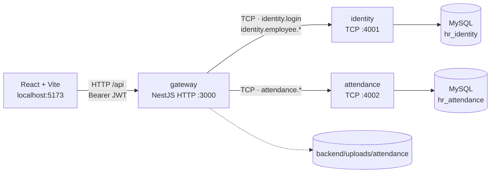
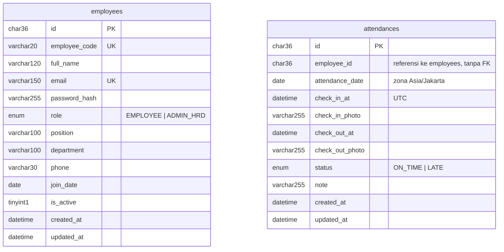

# DexaHR — Absensi WFH & Monitoring Karyawan

Satu aplikasi web dengan dua peran:

- **EMPLOYEE** — login, absen masuk/pulang dengan foto bukti, melihat riwayat absensinya sendiri.
- **ADMIN_HRD** — mengelola data master karyawan (tambah, ubah, nonaktifkan) dan memantau seluruh absensi secara *read only*.

Frontend React + Vite, backend NestJS dengan tiga proses terpisah (gateway HTTP + dua microservice TCP), dua database MySQL.

Brand, logo, dan warna diambil dari `frontend/public/DexaHR.png` + palette navy/sky di `frontend/src/index.css`; semuanya diatur dari `frontend/src/config/brand.ts`.

---

## Status pengerjaan

| Tahap | Isi | Status |
|---|---|---|
| 1 | Fondasi: repo, docker, monorepo NestJS, migration + seed, TCP ping, filter/pipe/helmet/CORS, frontend + token desain + routing dasar | **selesai** |
| 2 | Auth (login, JWT, guard role), CRUD karyawan di identity + endpoint gateway, halaman login, AppLayout, route guard, halaman `/admin/karyawan` | **selesai** |
| 3 | Absensi: check-in/out, upload foto, halaman `/absen` dan `/riwayat` | **selesai** |
| 4 | Monitoring admin, modal foto, state lengkap, e2e, README final | **selesai** |

Semua halaman yang disebut di `agent.md` sudah berfungsi: `/login`, `/absen`, `/riwayat`, `/admin/dashboard`, `/admin/karyawan`, `/admin/absensi`. Admin mendarat di `/admin/absensi` setelah login, karyawan di `/absen`.

---

## Arsitektur



- Frontend hanya bicara dengan **gateway**. Service TCP tidak diekspos ke luar.
- Satu instance MySQL, dua database terpisah, **tanpa foreign key lintas database**. Attendance menyimpan `employee_id` sebagai referensi biasa.
- Gateway yang menerbitkan JWT; identity hanya memvalidasi kredensial dan menyimpan data karyawan.
- Error dari service dikirim sebagai `RpcException` dengan payload `{ statusCode, error, message }`, lalu dipetakan gateway menjadi respons HTTP dengan bentuk yang sama.
- Kalau gateway butuh nama karyawan, ia mengambil absensi dari attendance lalu memanggil `identity.employee.getMany` dengan daftar `employee_id` — data karyawan tidak diduplikasi. Ini yang dipakai `GET /attendances` (monitoring admin): satu panggilan tambahan per halaman, bukan satu panggilan per baris.

### ER



- `hr_identity.employees` — unique `employee_code`, unique `email`.
- `hr_attendance.attendances` — unique `(employee_id, attendance_date)`, index `attendance_date`, index `status`.

---

## Stack

- **Backend**: NestJS 12 (mode monorepo), TypeORM (migration, `synchronize: false`), `class-validator` + `class-transformer`, `@nestjs/jwt` + `passport-jwt` + `bcrypt`, `helmet`, `@nestjs/throttler`, multer (tahap 3).
- **Database**: MySQL 8 via Docker.
- **Frontend**: React 19, Vite 8, React Router 7, TanStack Query 5, Axios, React Hook Form + Zod, Tailwind CSS 4.
- **Komponen UI**: dibuat sendiri di `frontend/src/components/ui/` (tanpa MUI/Ant/shadcn).

---

## Prasyarat

- Node.js 20 atau lebih baru
- Docker Desktop (untuk MySQL)
- npm

---

## Menjalankan dari nol

```bash
# 1. Dependensi
npm install
npm --prefix backend install
npm --prefix frontend install   # repo ini memakai yarn.lock; `yarn install` juga boleh

# 2. MySQL
npm run db:up                   # docker compose up -d (MySQL 8 di :3306)

# 3. Environment — satu file .env di root, dipakai compose + backend + script
cp .env.example .env
#    Nilai default sudah jalan untuk lokal (DB_PASSWORD=rootpassword, sama dengan
#    default docker-compose). Untuk apa pun selain lokal, ganti DB_PASSWORD dan
#    JWT_SECRET. Kalau ganti DB_PASSWORD untuk volume yang sudah ada,
#    jalankan `npm run db:reset`.

# 4. Skema + data contoh
npm run migrate                 # membuat database bila belum ada, lalu menjalankan migration
npm run seed                    # 3 akun + absensi contoh 7 hari terakhir

# 5. Jalankan semua proses
npm run dev                     # gateway, identity, attendance, frontend
```

Setelah `npm run dev`:

| Proses | Alamat |
|---|---|
| Frontend | http://localhost:5173 |
| Gateway API | http://localhost:3000/api |
| Health check (ping TCP ke kedua service) | http://localhost:3000/api/health |
| identity (TCP) | 127.0.0.1:4001 |
| attendance (TCP) | 127.0.0.1:4002 |

Script root lain: `npm run lint`, `npm run test`, `npm run build`, `npm run format`, `npm run db:down`, `npm run db:reset`.

---

## Akun seed (hanya lokal)

| Role | Email | Password |
|---|---|---|
| ADMIN_HRD | `admin@example.com` | `Admin123!` |
| EMPLOYEE | `budi@example.com` | `Employee123!` |
| EMPLOYEE | `sari@example.com` | `Employee123!` |

Akun di atas adalah data awal dari `npm run seed`. Lewat UI admin, nama/email/nomor bisa diubah, jadi isi database bisa berbeda dari tabel ini.

Seed juga mengisi absensi contoh untuk 5 hari kerja terakhir beserta file foto pratinjau (PNG yang dibuat oleh script seed). Semua akun ini **hanya untuk demo lokal** dan harus dihapus sebelum dipakai sungguhan.

---

## Endpoint

Prefix `/api`. Selain login, semua endpoint butuh header `Authorization: Bearer <token>`.

### Auth
| Method | Path | Role | Keterangan |
|---|---|---|---|
| POST | `/auth/login` | publik | `{ email, password }` → `{ accessToken, user }`. Rate limit 5/menit per IP |
| GET | `/auth/me` | semua | Profil dari token |

### Karyawan
| Method | Path | Role | Keterangan |
|---|---|---|---|
| GET | `/employees` | ADMIN_HRD | Pagination, `search` (nama/kode/email), filter `isActive`, `role` |
| GET | `/employees/:id` | ADMIN_HRD | Detail |
| POST | `/employees` | ADMIN_HRD | Tambah karyawan, admin mengisi password awal |
| PATCH | `/employees/:id` | ADMIN_HRD | Ubah data, password opsional, `isActive` untuk mengaktifkan kembali |
| DELETE | `/employees/:id` | ADMIN_HRD | Nonaktifkan (soft delete). Admin tidak bisa menonaktifkan akunnya sendiri |

Pagination: `page` (mulai 1), `limit` (default 10, maksimal 100). Bentuk respons list: `{ data, meta: { page, limit, total, totalPages } }`.

Format error seragam:

```json
{ "statusCode": 409, "error": "Conflict", "message": "Email sudah dipakai karyawan lain." }
```

### Absensi
| Method | Path | Role | Keterangan |
|---|---|---|---|
| GET | `/attendances/today` | EMPLOYEE | `{ date, serverTime, workStartTime, attendance }` untuk kartu absen hari ini |
| POST | `/attendances/check-in` | EMPLOYEE | `multipart/form-data`: `photo` (wajib, JPG/PNG/WEBP, ≤ 5 MB), `note` (opsional) |
| POST | `/attendances/check-out` | EMPLOYEE | Sama seperti check-in; hanya boleh setelah check-in hari itu |
| GET | `/attendances/me` | EMPLOYEE | Riwayat milik sendiri; filter `dateFrom`, `dateTo`, pagination |
| GET | `/attendances` | ADMIN_HRD | Semua absensi + nama karyawan; filter `dateFrom`, `dateTo`, `employeeId`, `status`, pagination |
| GET | `/attendances/summary` | ADMIN_HRD | Ringkasan hari ini: `present`, `onTime`, `late`, `checkedOut`, `totalActiveEmployees`, `notCheckedIn` |
| GET | `/attendances/:id/photo?type=in\|out` | pemilik atau ADMIN_HRD | Streaming foto dari `UPLOAD_DIR`, tidak pernah publik |

Aturan yang ditegakkan: satu check-in dan satu check-out per hari (`409` bila diulang), jam diambil dari server (`APP_TIMEZONE`, default `Asia/Jakarta`), status `ON_TIME`/`LATE` dihitung dari `WORK_START_TIME` + `LATE_TOLERANCE_MINUTES`, dan file foto dihapus lagi kalau penyimpanan ke database gagal.

Endpoint admin hanya untuk membaca. Tidak ada `PATCH`/`DELETE` absensi, dan endpoint milik karyawan (`today`, `check-in`, `check-out`, `me`) menolak token ADMIN_HRD dengan `403`.

### Health
| Method | Path | Keterangan |
|---|---|---|
| GET | `/health` | Ping `ping` via TCP ke identity dan attendance |

### Monitoring admin
- `/admin/absensi` menampilkan tabel absensi semua karyawan: nama + kode + divisi, tanggal, jam masuk/pulang, status, dan tombol **Lihat bukti**.
- Filter: rentang tanggal, karyawan (dropdown, 100 karyawan pertama), status (tepat waktu/terlambat), plus tombol pintas **Hari ini**.
- Modal bukti menampilkan foto masuk dan pulang berdampingan, keduanya diambil lewat endpoint ber-Bearer (bukan URL publik). Kalau check-out belum ada, kolom foto pulang menjelaskan itu.
- `/admin/dashboard` menampilkan empat kartu ringkasan hari ini (hadir, terlambat, sudah pulang, belum absen) dan lima absensi terbaru.
- Semua daftar punya state loading (skeleton), kosong, dan error dengan tombol coba lagi.

---

## Struktur folder

```
/
├── backend/
│   ├── apps/
│   │   ├── gateway/       HTTP API, auth guard, upload foto, komposisi data
│   │   ├── identity/      microservice TCP: login + data master karyawan
│   │   └── attendance/    microservice TCP: absensi, status, rekap
│   ├── libs/common/       pattern pesan, enum, DTO bersama, pesan error, filter, util
│   ├── scripts/           migrate.ts, seed.ts, generator foto contoh
│   └── uploads/           foto absensi (git-ignored)
├── frontend/src/
│   ├── components/ui/     Button, Input, Select, Textarea, Badge, Card, StatCard,
│   │                      Modal, DataTable, ConfirmDialog, Toast, Avatar, PageHeader,
│   │                      PhotoCapture, PhotoPreview, icons
│   ├── components/layout/ AppLayout, Sidebar, Topbar
│   ├── features/          auth (provider, hook, guard), employees (query + form modal),
│   │                      attendance (query, mutasi, jam server, badge status,
│   │                      AttendancePhoto + AttendancePhotoModal)
│   ├── pages/             LoginPage, employee/AbsenPage, employee/RiwayatPage,
│   │                      admin/AbsensiPage, admin/DashboardPage, admin/KaryawanPage
│   └── lib/               api (axios), session, format (Intl Asia/Jakarta), query-client
├── docker-compose.yml     MySQL 8 (database dibuat oleh `npm run migrate`)
├── .env                   konfigurasi lokal, git-ignored, disalin dari .env.example
└── .env.example
```

---

## Keputusan dan Batasan

Hal-hal yang diputuskan sendiri selama pengerjaan (lihat juga `agent.md` bagian 12):

1. **TCP tanpa message broker.** Gateway memakai `ClientProxy` langsung ke identity/attendance. Cukup untuk skala tes ini; untuk produksi sebaiknya diganti Redis/NATS/RabbitMQ agar ada retry, queue, dan discovery.
2. **JWT diterbitkan gateway.** Identity hanya memverifikasi password dan mengembalikan profil. Token berisi `sub`, `role`, `email`, berlaku 8 jam.
3. **Profil divalidasi ulang setiap request.** `JwtStrategy` memanggil `identity.employee.get` supaya akun yang dinonaktifkan langsung kehilangan akses walau tokennya belum kedaluwarsa. Konsekuensinya ada satu round-trip TCP tambahan per request.
4. **Token di `localStorage`.** Cukup untuk scope tes; tidak ada refresh token dan rawan XSS. Alternatif produksi: cookie `HttpOnly` + CSRF token.
5. **Soft delete.** `DELETE /employees/:id` hanya mengubah `is_active = 0`. Riwayat absensi tetap bisa ditelusuri. Untuk mengaktifkan kembali, kirim `PATCH { "isActive": true }`.
6. **Validasi dua lapis.** Gateway memvalidasi body/query, service memvalidasi ulang payload RPC dengan DTO yang sama dari `libs/common`. Payload antar-service memakai amplop ber-DTO (`{ id, dto, actorId }`).
7. **Pesan validasi berbahasa Indonesia.** class-validator memeriksa decorator dari yang terakhir ditulis, jadi urutan decorator di DTO diatur supaya pesan "wajib diisi" muncul sebelum pesan panjang/format. `ValidationPipe` memakai `stopAtFirstError`.
8. **Palette mengikuti brand yang disiapkan di `index.css`.** Warna diambil dari blok palette di bagian bawah file tersebut: navy `#0A2B4C` sebagai primary, sky `#8ED1FC` sebagai aksen, red `#EA4335`, background `#F4F6F8`, teks `#1C1D1F`. `design.md` tetap dipakai untuk struktur, ritme, dan pola komponen, bukan warnanya. Beberapa nilai digeser agar kontras lolos WCAG AA: red `#EA4335` (3.9:1 di atas putih) dipakai sebagai `#D33426` (4.9:1) untuk teks/tombol, dan sky hanya untuk isian/aksen dekoratif karena sebagai teks hanya 1.7:1.
9. **Tailwind 4 (CSS-first).** Token desain ada di `frontend/src/index.css` pada blok `@theme`, bukan `tailwind.config.js` (Tailwind 4 tidak lagi memakai file config untuk token).
10. **Linter backend memakai oxlint.** Sudah terpasang di scaffold (`oxlint --type-aware`) dan jalan tanpa konfigurasi tambahan; Prettier tetap dipakai untuk format. Frontend memakai ESLint 10 + typescript-eslint.
11. **Halaman awal admin `/admin/absensi`.** Sesuai `agent.md`, setelah login admin langsung mendarat di halaman monitoring. Sebelum tahap 4 halaman itu belum ada isinya sehingga admin sementara diarahkan ke `/admin/karyawan`; sekarang sudah dikembalikan (`frontend/src/features/auth/paths.ts`).
12. **Foto seed adalah placeholder.** Script seed membuat PNG gradient 480×360 sebagai isi `uploads/attendance/YYYY/MM/`, supaya modal pratinjau admin (tahap 4) punya file yang benar-benar bisa dibuka.
13. **Seeder idempoten.** Data dicek per email / per `(employee_id, attendance_date)` sebelum diinsert, jadi `npm run seed` boleh dijalankan berulang.
14. **Timestamp dari klien tidak pernah dipakai.** Jam check-in/out diambil dari `new Date()` di service attendance, koneksi MySQL memakai `timezone: 'Z'`, kolom `DATETIME(6)` menyimpan UTC, dan frontend hanya menampilkan WIB lewat `Intl`.
15. **Foto tidak pernah publik.** Nama file UUID (nama asli dari klien diabaikan), disimpan per bulan (`uploads/attendance/YYYY/MM/`), hanya bisa diambil lewat endpoint ber-Bearer yang memeriksa pemilik atau ADMIN_HRD. File ditolak kalau bukan JPG/PNG/WEBP atau lebih dari `MAX_UPLOAD_MB`, dan dihapus lagi bila RPC ke service attendance gagal supaya tidak ada file yatim.
16. **Check-out ikut di tahap 3.** `agent.md` hanya menyebut check-in, tetapi status absensi dan halaman riwayat butuh jam pulang; kontraknya ditambahkan sebagai `POST /attendances/check-out` dengan aturan yang sama (foto wajib, sekali per hari).
17. **Satu `.env` di root.** Docker compose, ketiga service, dan script `migrate`/`seed` membaca file yang sama (`envFilePath: ['../.env', '.env']`), jadi `DB_PASSWORD` hanya ada di satu tempat. Compose memakai `${DB_PASSWORD:?…}` tanpa default: tanpa `.env`, `npm run db:up` berhenti dengan pesan jelas, bukan diam-diam memakai password tebakan.
18. **Mengganti password MySQL butuh volume baru.** `MYSQL_ROOT_PASSWORD` hanya dipakai saat volume masih kosong. Setelah itu password tersimpan di dalam volume, jadi ganti `DB_PASSWORD` disertai `npm run db:reset` — bukan hanya restart container.
19. **Komposisi nama karyawan dilakukan gateway.** `attendance.list` hanya mengembalikan `employeeId`; gateway mengumpulkan id unik satu halaman lalu memanggil `identity.employee.getMany` sekali. Responsnya hanya memuat id, kode, nama, jabatan, divisi, dan status aktif — email dan nomor telepon tidak ikut ke halaman monitoring. Karyawan yang sudah dihapus dari identity (kasus teoretis) tampil sebagai "Karyawan tidak dikenal", bukan membuat satu baris hilang.
20. **Filter karyawan memakai 100 karyawan pertama.** Dropdown memakai `GET /employees?limit=100` (batas maksimal API) tanpa pencarian server-side. Cukup untuk skala tes; kalau datanya ribuan, ganti dengan combobox yang mencari ke server.
21. **Ringkasan dashboard dihitung dari dua service.** Attendance menghitung `present/onTime/late/checkedOut` untuk tanggal WIB hari ini, identity memberi jumlah karyawan aktif, gateway menghitung `notCheckedIn = aktif − present` (tidak pernah negatif). Tidak ada tabel rekap tambahan.
22. **Logo dipangkas otomatis dari file asli.** `frontend/public/DexaHR.png` punya banyak ruang kosong transparan; dipangkas dengan skrip PIL menjadi `dexahr-logo.png` (lockup ikon + wordmark, tinggi 128 px), `dexahr-mark.png` (ikon saja, 96 px), dan `dexahr-favicon.png` (64 px). Nama brand, tagline, dan path logo ada di `frontend/src/config/brand.ts`; nama aplikasi juga dipakai di `<title>` dan `index.html`.
23. **E2E login berjalan tanpa MySQL.** Test `backend/test/auth.e2e.spec.ts` menembak HTTP gateway sungguhan lewat supertest, tetapi identity diganti stub dan `@nestjs/throttler` di-mock. Throttler 6.x masih CJS yang me-require `@nestjs/common` (ESM-only); aplikasi jalan karena Node 20.19+ mendukung `require(esm)`, sedangkan runtime Jest belum. Rate limit tetap aktif saat aplikasi berjalan — yang di-mock hanya di test. Jalankan dengan `npm run test:e2e`.

---

## Menjalankan test

```bash
npm test            # Jest (backend), 29 test termasuk e2e login
npm run test:e2e    # hanya test e2e login di backend/test/
npm run lint        # oxlint (backend) + ESLint (frontend)
npm run build       # build ketiga app + build frontend
```

Test yang ada sekarang:

- `libs/common/src/errors/rpc-error.spec.ts` — pemetaan error RPC → HTTP, termasuk bentuk yang dibungkus transport TCP (regresi yang sempat membuat login gagal mengembalikan 500).
- `apps/identity/src/employees/employees.service.spec.ts` — soft delete, larangan menonaktifkan akun sendiri, email duplikat, pembuatan kode otomatis, metadata pagination.
- `apps/attendance/src/attendances/attendances.service.spec.ts` — check-in tepat waktu vs terlambat (termasuk batas toleransi), absen ganda ditolak, check-out butuh check-in, check-out ganda ditolak, status hari ini, filter `listAll`, dan hitungan `summary`.
- `test/auth.e2e.spec.ts` — login lewat HTTP: token + profil tanpa hash, kredensial salah → 401, body tidak valid → 400, dan token hasil login bisa dipakai di `/api/auth/me`.

Jest berjalan dalam mode ESM (`--experimental-vm-modules`) karena paket `@nestjs/*` versi 12 hanya tersedia sebagai ESM.

---

## Batasan dan pengembangan lanjutan

Tahap 1–4 selesai. Yang sengaja tidak dikerjakan karena di luar scope `agent.md`:

- Ekspor CSV absensi, filter per departemen di halaman monitoring, dan daftar "siapa belum absen" per nama (dashboard hanya menampilkan jumlahnya).
- Dropdown karyawan di filter monitoring baru memuat 100 karyawan pertama; untuk data besar perlu pencarian server-side.
- Token di `localStorage` tanpa refresh token (lihat bagian Keputusan). Tidak ada fitur lupa password; reset dilakukan admin HRD.
- Komunikasi antar-service masih TCP tanpa broker, tanpa retry/queue.
